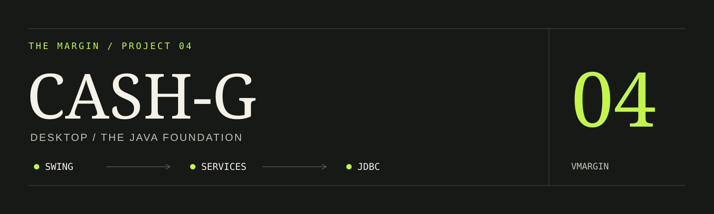
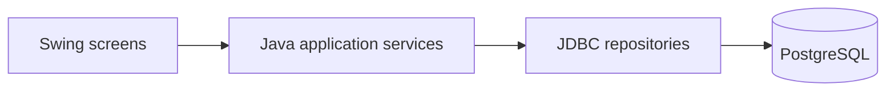

# CASH-G / JCash: Java Desktop Banking

**The desktop foundation: Swing screens, Java services, and JDBC transactions.**

An educational Java banking simulator built for Java Programming NC III training and assessment preparation. It uses synthetic data and PostgreSQL. The [Spring Boot web application](https://github.com/vmargin/cashg.onrender.com) lives in a separate repository.

## Implemented workflows

- Mobile-number/PIN login and registration.
- Account balance, cash-in, and atomic customer-to-customer transfers.
- Per-user transaction history.
- Role-aware administration.

## Architecture



Java services hold the application rules; JDBC repositories handle persistence and transaction boundaries. JUnit tests exercise domain and repository behavior. This is a learning simulator, not real financial software.

**Stack:** Java 21, Swing, JDBC, PostgreSQL, JUnit 5, Maven Wrapper.

## Local development

Install Temurin JDK 21 and PostgreSQL. Clone the repository, then check the toolchain:

```powershell
git clone https://github.com/vmargin/banking-app.git
cd banking-app
.\scripts\dev.ps1 -Task doctor
.\scripts\dev.ps1 -Task compile
```

Database connections read these environment variables:

| Variable | Purpose |
| --- | --- |
| `BANKING_DB_URL` | JDBC PostgreSQL URL; defaults to `jdbc:postgresql://localhost:5432/banking_app`. |
| `BANKING_DB_USER` | Required local database user. |
| `BANKING_DB_PASSWORD` | Required local database password. |

Create a dedicated empty local database and apply the included schema, replacing `YOUR_LOCAL_USER` with your local PostgreSQL role:

```powershell
createdb -h localhost -U YOUR_LOCAL_USER banking_app
psql -h localhost -U YOUR_LOCAL_USER -d banking_app -f src/main/resources/schema.sql
```

The schema creates the tables and a synthetic administrator (`09990000000` / `1234`). Apply it only to a new development database: rerunning it updates that demo administrator's credentials. Set the environment variables above in the terminal used to launch the application. For a database-free setup, use the separate web project's H2 demo.

After configuring the local database, `.\scripts\dev.ps1 -Task run` launches `com.vmargin.banking.Main`. Never use real account details or PINs.

## Verify

```powershell
.\scripts\dev.ps1 -Task style
.\scripts\dev.ps1 -Task test
.\scripts\dev.ps1 -Task verify
```

Database-backed checks require the isolated local database and may skip without it. A passing suite covers the exercised code paths; it does not replace a manual walkthrough of Swing screens. No stale historical test count is presented as a current result.

## Contribution and relationship to web v2

I hand-coded desktop v1's Java interface, services, JDBC persistence, and tests. AI assistance supports requirements, tooling, issue structure, and review. Web v2 is a separate AI-assisted adaptation with Spring Boot and Thymeleaf; its screenshots do not depict this Swing application.

---

[More projects](https://github.com/vmargin) · [Portfolio](https://vmargin.github.io/) · [LinkedIn](https://www.linkedin.com/in/vmargin/)
